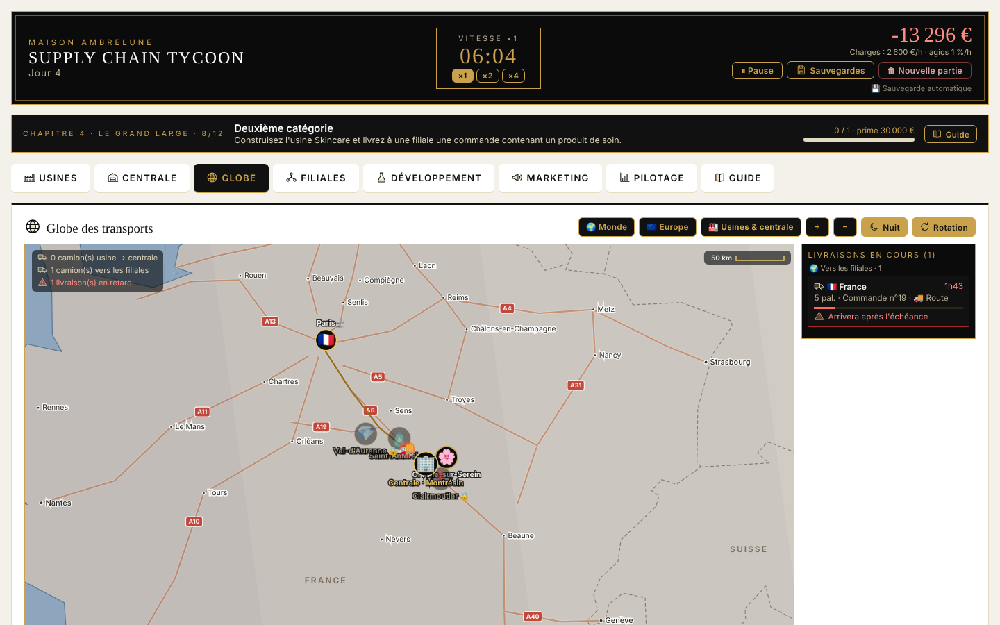
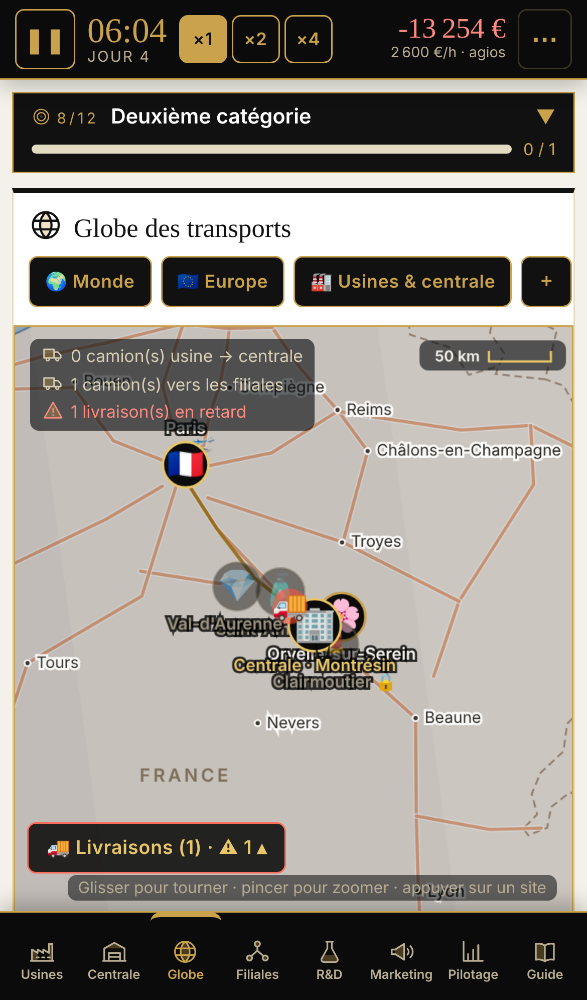

# Supply Chain Tycoon · Maison Ambrelune

Supply Chain Tycoon est un jeu de gestion open source. Vous prenez la tête de la supply chain de la Maison Ambrelune, une maison de parfum et de beauté : vous achetez les composants, faites tourner les usines et la centrale logistique de **Montrésin** (Yonne), puis livrez les filiales qui vendent dans le monde. Le but est de faire tourner toute la chaîne en équilibre, sans se focaliser sur un seul maillon.

| Ordinateur | Téléphone |
|---|---|
|  |  |

## Jouer

Aucune installation nécessaire : télécharger **[`dist/SupplyChainTycoon.html`](dist/SupplyChainTycoon.html)** et l'ouvrir dans un navigateur (Chrome, Edge, Safari, Firefox). Le fichier contient tout le jeu, il fonctionne hors ligne.

- La partie est sauvegardée automatiquement dans le navigateur (clé `supply-chain-tycoon-save-v5`).
- Le jeu s'adapte à l'ordinateur comme au téléphone (barre d'onglets en bas sur mobile).
- 1 seconde réelle = 1 minute de jeu à la vitesse ×1 ; vitesses accélérées disponibles.

## Le jeu

**Progression par objectifs.** 12 jalons répartis en 5 chapitres, de « L'atelier » au « Tour du monde ». Les mécaniques se débloquent au fil de la partie, chacune expliquée par une fiche « Dans la vraie vie » sur le métier de la supply chain.

**Achats.** Matières premières (alcool, essences, actifs, pigments…) et composants de conditionnement (flacons, bouchons, étuis, cartons, palettes), avec des délais qui dépendent de la distance des fournisseurs (verre de la vallée de la Bresle, essences de Grasse…).

**Usines.** Ouvertes l'une après l'autre : le parfum à Orvelle-sur-Serein, le soin à Saint-Ambrel, le maquillage à Clairmoutier, les parfums d'exception à Val-d'Aurenne. Pesée, cuves, lignes de conditionnement, kitting, ordres de fabrication pilotés par le S&OP.

**Centrale logistique de Montrésin.** Jusqu'à 8 cellules et environ 55 000 emplacements palettes, à équiper petit à petit en racks. Quatre postes à staffer : réception, rangement, préparation, chargement. Chantiers d'amélioration continue (kaizen), équipements, WMS.

**Développement.** Onglet R&D pour lancer de nouvelles références : eaux de parfum, soins, maquillage, extraits.

**Filiales.** De la France à l'Australie, en passant par le travel retail de Dubaï et la Chine. Elles vendent sur leur marché, commandent à la centrale selon un stock cible et la jugent sur l'**OTIF**, avec un diagnostic des causes de retard. Choix routier, maritime ou aérien, avec impact CO₂.

**Globe 3D.** Un globe zoomable où circulent en direct camions, bateaux et avions entre fournisseurs, usines, centrale et filiales, avec le cycle jour/nuit.

**Aléas.** Pannes informatiques, vols de camions, grèves, pénuries et autres événements.

## Organisation du dépôt

L'architecture cible et le plan de migration sont décrits dans **[docs/architecture.md](docs/architecture.md)**.

```
src/
  main.jsx                       Point d'entrée navigateur
  SupplyChainTycoon.jsx          Le jeu (en cours de découpage, voir docs/architecture.md)
  brands/ambrelune.js            Habillage : noms de la maison et des produits
  domain/                        Règles du jeu en JavaScript pur (ex. domain/dc/storage.js : racks de la centrale)
  ui/globe/geoData.js            Contours des terres pour le globe (Natural Earth)
tests/                           Tests (node:test) : règles, simulation de 3 jours, habillage, architecture
  ui/smoke.mjs                   Test de fumée de l'interface (ordinateur et téléphone), npm run test:ui
.claude/agents/                  Agents Claude Code : chef-de-projet, dev, testeur
dist/
  SupplyChainTycoon.html         Le jeu, en une seule page jouable hors ligne
scripts/build.mjs                Construction de la page HTML autonome
docs/
  architecture.md                Diagnostic, architecture cible, plan de migration, stratégie de tests
  apercus/                       Captures d'écran (ordinateur.png, telephone.png)
```

## Modifier et reconstruire

Prérequis : Node.js 22 ou plus récent.

```bash
npm install
npm test               # ≈ 5 s : règles, golden master (3 jours de jeu simulés), habillage, architecture
npm run build          # construit dist/SupplyChainTycoon.html
npm run test:ui        # après le build : ouvre chaque onglet sur ordinateur et téléphone (Playwright requis)
```

Les noms de la maison et des produits ne sont pas dans le code du jeu : `import BRAND from '@brand'` pointe, au build, vers `src/brands/ambrelune.js`.

Si une modification change volontairement les règles du jeu, le golden master échoue : relancer avec `UPDATE_SNAPSHOT=1 npm test` et relire le diff de `tests/snapshots/`.

## Travailler avec les agents Claude Code

Trois agents spécialisés sont définis dans `.claude/agents/`. Claude Code les charge automatiquement quand il est lancé dans ce dépôt (en local avec `claude`, ou dans une session Claude Code sur le web).

| Agent | Rôle | Peut modifier |
|---|---|---|
| `chef-de-projet` | Cadre la demande, découpe en petites PR, vérifie que toute la supply chain reste en équilibre et que tout s'inscrit dans `docs/architecture.md`. | Rien (lecture seule) |
| `dev` | Implémente selon l'architecture (domaine pur, devis puis application, habillage dans `brands/`), ajoute les tests unitaires, vérifie `npm test` et le build. | Le code et les tests |
| `testeur` | Lance `npm test`, `npm run build` et `npm run test:ui`, regarde les captures ordinateur et téléphone, rend un rapport de bugs. | Seulement `tests/` |

**Les appeler.** Il suffit de les nommer dans la demande :

```
Demande au chef-de-projet un plan pour ajouter les coffrets de Noël.
Utilise l'agent dev pour réaliser la PR 1 du plan.
Fais vérifier par le testeur avant d'ouvrir la PR.
```

On peut aussi enchaîner les trois en une phrase : « Ajoute les retours produits : chef-de-projet pour le plan, puis dev, puis testeur ». La commande `/agents` dans Claude Code liste les agents et permet de les modifier.

**Les modifier.** Chaque agent est un simple fichier Markdown : un en-tête (`name`, `description` qui dit quand l'utiliser, `tools` autorisés, `model`) suivi de ses consignes. Pour changer son comportement, on modifie le texte ; pour en ajouter un, on crée un nouveau fichier dans `.claude/agents/`.
